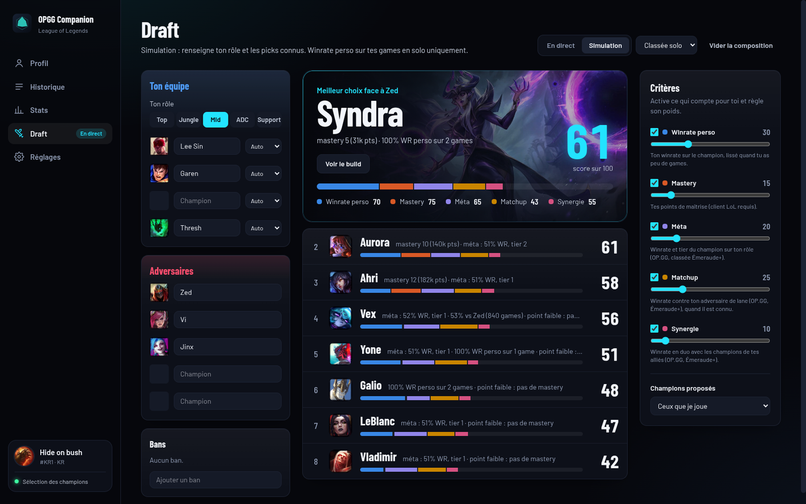
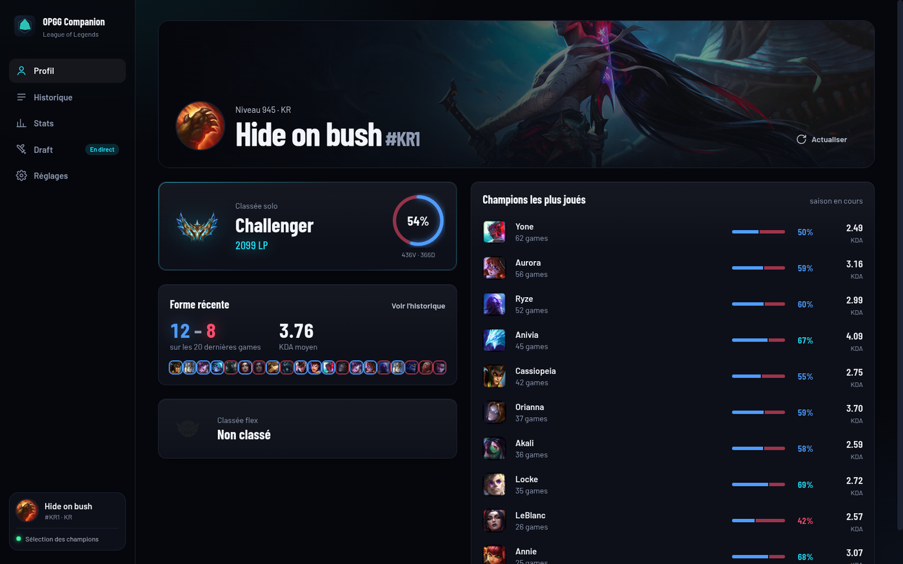
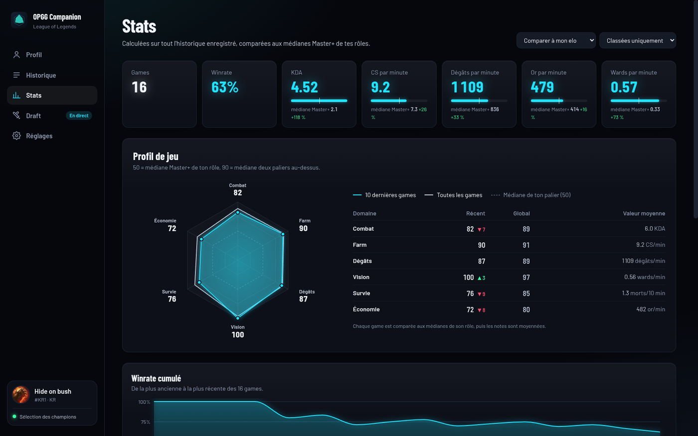
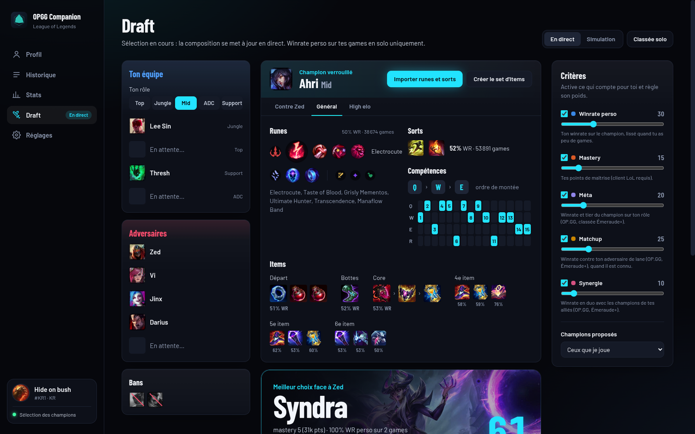
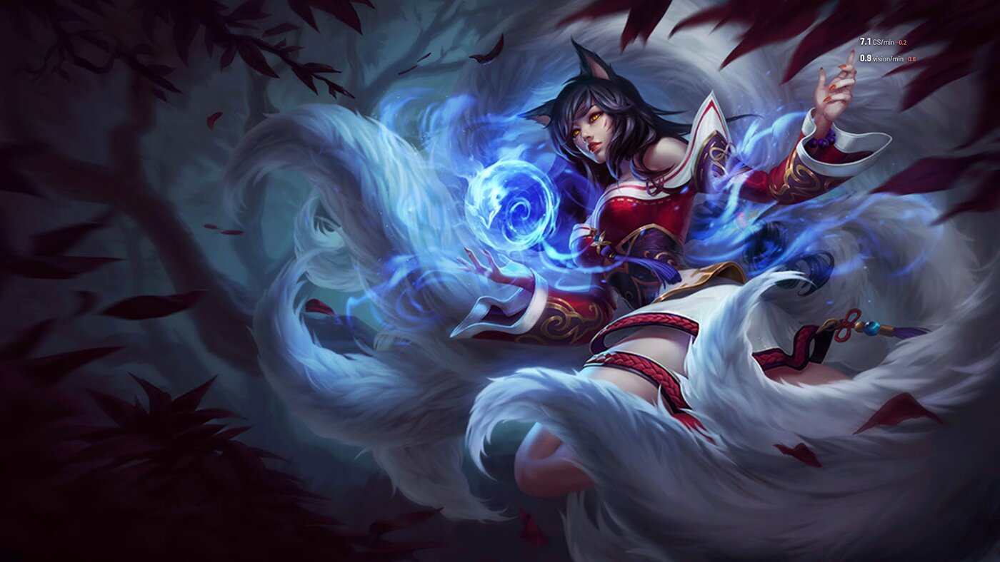
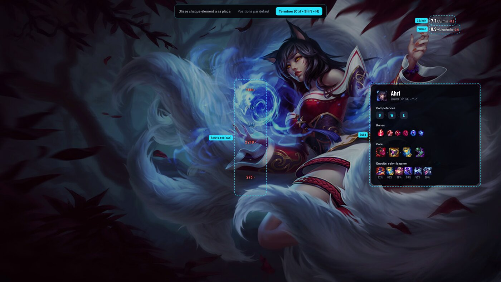

# OPGG Companion

Compagnon **League of Legends pour Windows** : ton profil et ton historique, des stats comparées à ton elo, un draft helper qui
te propose les meilleurs picks pendant la sélection, l'import du build en un clic et un overlay discret en partie.

Données : [OP.GG MCP](https://github.com/opgginc/opgg-mcp), le client LoL installé sur ton PC et l'API de jeu locale.



## Télécharger

Va dans [**Releases**](https://github.com/odinalx/opgg-companion/releases/latest) et prends :

- `OPGG Companion-Setup-x.y.z.exe` : installeur ;
- ou `OPGG Companion-Portable-x.y.z.exe` : version portable, sans installation.

Les exécutables ne sont pas signés : au premier lancement, Windows SmartScreen affiche « Windows a protégé votre ordinateur ».
Clique sur **Informations complémentaires → Exécuter quand même**.

## Fonctionnalités

### Connexion

- **Se connecter avec Riot** ouvre le Riot Client officiel. Une fois League of Legends lancé, ton compte est reconnu
  automatiquement. Ton mot de passe reste chez Riot : l'app lit seulement le client local.
- Sans lancer le jeu, tu peux consulter n'importe quel profil avec un Riot ID (`Pseudo#TAG`).

### Profil, historique et stats

| Profil | Stats |
|---|---|
|  |  |

- Rang, LP, winrate, champions de la saison et forme récente.
- Historique détaillé : KDA, CS/min, dégâts, vision, items, runes, et le détail des 10 joueurs de chaque game. Il est
  conservé sur ton PC et s'allonge à chaque synchronisation (OP.GG fournit les 20 dernières games, le client LoL jusqu'à 100).
- **Stats comparées à ton elo** : chaque stat est mise en face de la médiane de ton palier pour tes rôles. Tu peux aussi
  te comparer à un autre palier, de Fer à Master+.
- **Profil de jeu en hexagone** : combat, farm, dégâts, vision, survie, économie. 50 = médiane de ton palier,
  90 = médiane deux paliers au-dessus.

### Draft helper

Pendant la sélection des champions (ou en simulation), l'app classe les champions que tu peux jouer selon cinq critères.
Chaque critère s'active ou se désactive et a son propre poids :

- **Winrate perso** : ton winrate sur le champion, lissé quand tu as peu de games. En classée solo, seules tes games solo
  comptent ; en flex, solo et flex.
- **Mastery** : tes points de maîtrise.
- **Méta** : winrate et tier du champion sur ton rôle.
- **Matchup** : winrate contre ton adversaire de lane.
- **Synergie** : winrate en duo avec les champions de tes alliés.

Méta, matchups et synergies viennent d'OP.GG : parties classées **Émeraude+** du patch en cours.
Un modèle optionnel apprend sur ton historique quels critères comptent le plus dans tes victoires.

### Build au verrouillage du champion



- **Contre ton adversaire** : runes, sorts et items les plus joués dans ce matchup.
- **Général** : le build OP.GG du champion sur ton rôle.
- **High elo** : les builds réels des meilleurs joueurs du champion, regroupés par runes et sorts joués ensemble,
  avec les items les plus fréquents dans ces games.

Un clic importe la page de runes, les sorts (Flash reste sur ta touche habituelle) et un set d'items dans le client.
L'import automatique des runes et des sorts au verrouillage s'active dans les réglages.

### En partie

| Overlay | Écart d'or (Tab) |
|---|---|
|  |  |

- **Overlay minimal** : quelques chiffres seulement. Tes CS, comparés à la médiane de ton elo à la même minute, avec les
  repères à 10, 15 et 20 minutes ; ton score de vision ; en option, l'or par minute et la participation aux kills.
- **Écart d'or sur le tableau des scores** : quand tu maintiens Tab, l'écart de chaque lane s'affiche sur la ligne centrale
  du tableau, dans la couleur de l'équipe qui mène.
- **Build à la demande** : `Ctrl + Shift + B`.
- **Chaque élément se déplace** : `Ctrl + Shift + M` en partie, puis glisse les éléments à la souris.

  

- L'overlay n'existe que pendant une partie. Il ne prend jamais le focus : les clics et le clavier restent au jeu.
- Il demande LoL en mode d'affichage **Sans bordure** (en plein écran, Windows masque les overlays).
- Tu préfères ne rien avoir sur le jeu ? Choisis **Fenêtre séparée** : les mêmes infos s'affichent dans une fenêtre sur
  l'écran de ton choix, par exemple un second écran.

Les raccourcis se changent dans les réglages.

## À savoir

- **Écart d'or** : estimé à partir de la valeur des items de chaque joueur. Le jeu ne donne pas l'or des autres joueurs.
- **Dégâts par minute** : non disponibles en partie, le jeu ne les fournit pas.
- **Tableau des scores** : sa taille dépend de ta résolution. Si les chiffres ne tombent pas pile sur les lignes, aligne-les
  une fois avec le mode déplacement et le curseur « écart entre lignes » (Réglages → Overlay).
- **Repères par elo** : médianes calculées sur 800 games classées récentes d'OP.GG, 100 par palier, regroupées selon l'elo
  moyen de la partie. Le score de vision n'étant pas fourni par OP.GG, ses repères sont estimés.
- **Écriture dans le client** : l'app ne touche au client LoL que pour importer runes, sorts et sets d'items, et seulement
  quand tu le demandes (ou si tu actives l'import automatique). Elle n'automatise aucune action de jeu.

## Développement

```bash
npm install
npm run dev          # lance l'app
npm test             # tests unitaires
npm run build:win    # installeur et version portable Windows dans dist/
```

Sans Windows ni League of Legends, `npm run mock:lcu` démarre un faux client qui simule un compte, une sélection des
champions et, avec `MOCK_INGAME=1`, une partie en cours. Lance ensuite l'app avec les variables affichées par le script.

| Commande | Rôle |
|---|---|
| `npm run smoke:opgg` | vérifie le client OP.GG et le draft helper contre l'API réelle |
| `npm run bench:build` | recalcule les médianes par elo (`src/main/data/benchmarks.json`) |
| `OPGG_CAPTURE_DIR=<dossier>` | fait parcourir toutes les pages à l'app et en enregistre une capture |

| Dossier | Rôle |
|---|---|
| `src/main/lcu` | client LoL local : détection, API, sélection des champions, import de build |
| `src/main/live` | API de jeu, stats en direct, overlay |
| `src/main/opgg` | client OP.GG MCP et lecture de son format de réponse |
| `src/main/draft` | score des champions, collecte des données, modèle |
| `src/main/builds` | variantes de builds high elo |
| `src/renderer` | interface React |

La CI GitHub teste chaque push et publie l'installeur dans une release pour chaque tag `v*`.

OPGG Companion n'est ni affilié à OP.GG ni à Riot Games, ni soutenu par eux. League of Legends est une marque de Riot Games, Inc.
